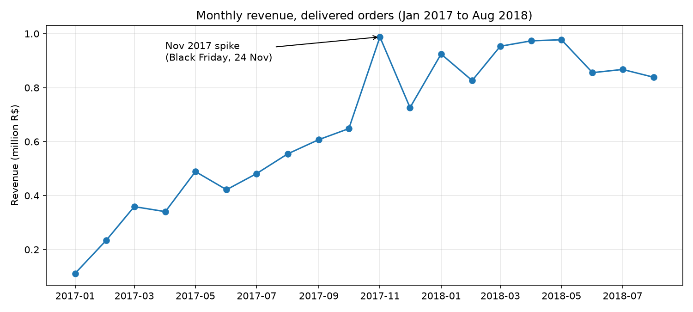
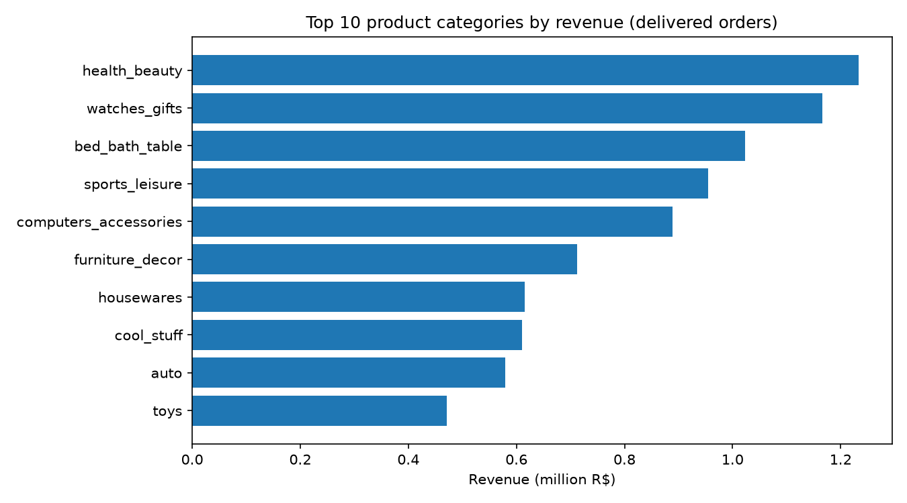
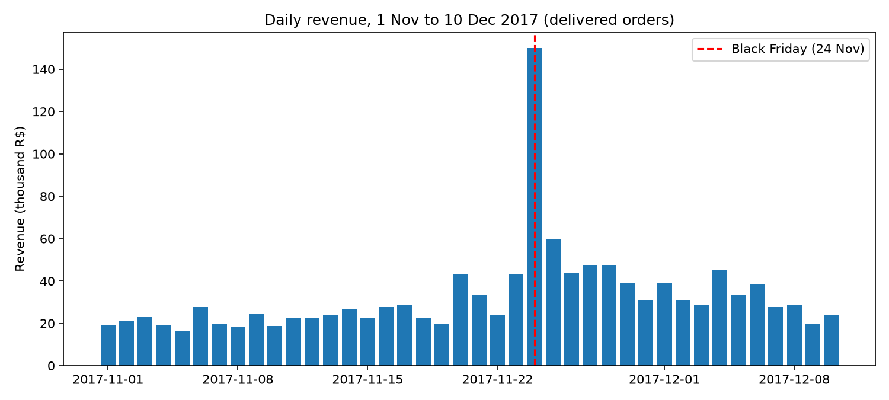
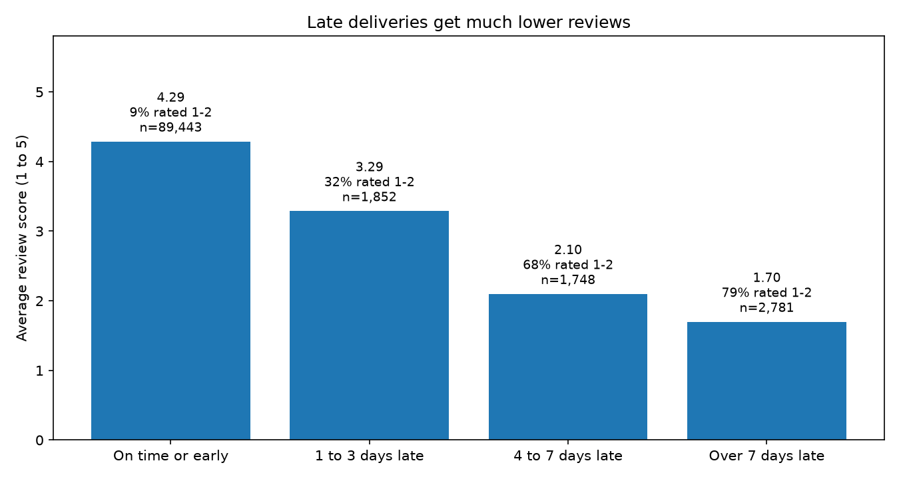
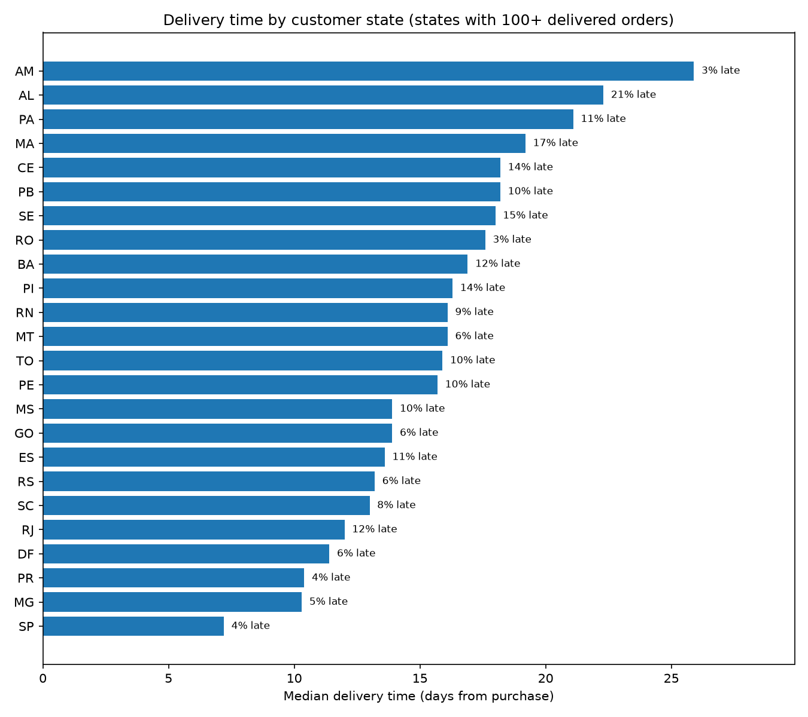
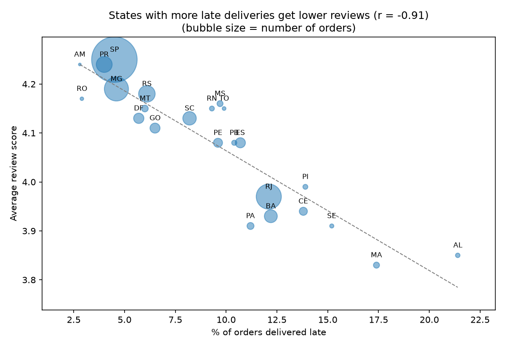

# Olist E-commerce Analysis

Business analysis of the Olist Brazilian e-commerce public dataset (about 99k orders, spanning 2016 to 2018).
Tools: Python, DuckDB (SQL), pandas, matplotlib, numpy.

## Business questions
1. Which product categories generate the most revenue, and how has revenue trended month by month?
2. How late are deliveries compared with the estimated date, and does lateness hurt review scores?
3. Which states have the most customers, and where is delivery slowest?
4. How many customers buy more than once? (In progress)
5. Which payment methods are used most, and how do they differ in order value? (In progress)

## Definitions and data notes
- **Revenue** = sum of item price, excluding freight. Freight is a shipping charge, not product sales.
- Revenue and delivery metrics use **delivered** orders only. Canceled, unavailable and in-progress orders are excluded.
- Customers are counted by `customer_unique_id` (one per person), not `customer_id` (one per order). Customer counts by state include all customers, whether or not their orders were delivered.
- State-level delivery statistics only include states with at least 100 delivered orders (AC, AP and RR are excluded).
- Currency is Brazilian reais (R$).
- Reviews are deduplicated to one per order (814 duplicate review IDs in the raw data).
- Monthly trends use full months only (Jan 2017 to Aug 2018). There are no delivered orders in Nov 2016 or after Aug 2018.
- Lateness is measured in calendar days against the estimated delivery date. 646 delivered orders (0.7%) have no review and are excluded from the review analysis.

## Steps to reproduce
1. Clone the repo and create an environment (Python 3.12 recommended):
   ```
   git clone https://github.com/eQuaEnoo/olist-ecommerce-analysis.git
   cd olist-ecommerce-analysis
   python -m venv .venv
   .venv\Scripts\activate
   pip install -r requirements.txt
   ```
2. Download the **Brazilian E-Commerce Public Dataset by Olist** from Kaggle and place the 9 CSV files in `data/raw/`.
3. Open `notebooks/01-explore.ipynb`, select the `.venv` kernel and run all cells in order. The first cell builds a local DuckDB database from the CSVs, and the rest run the cleaning and analysis.

The raw data and the database file are not stored in this repo (see `.gitignore`).

## Findings

### Q1: Revenue by category and over time
- Revenue is spread across many categories: the top 5 make up about 40% of revenue and the top 10 about 62%.
- health_beauty (R$1.23M, 9.3%) and watches_gifts (R$1.17M, 8.8%) lead. watches_gifts earns its place with far fewer orders than bed_bath_table (5,493 vs 9,272), meaning a higher spend per order (about R$212 vs R$110).
- Monthly revenue grew from about R$112k in Jan 2017 to R$648k in Oct 2017, then jumped 52% to R$988k in Nov 2017. Daily data shows why: on Black Friday (24 Nov 2017) revenue hit R$150k, 6.6x the median day in 1 to 20 Nov (R$23k) and about 15% of the whole month. Revenue stayed elevated in the days after and mostly above early-November levels through December, so the rise reflects the Black Friday spike plus a general seasonal lift. Monthly revenue then settled around R$0.83 to 0.98M through 2018.
- Jan to Aug 2018 revenue was about 2.4x the same months of 2017 (from a small early-2017 base).





### Q2: Delivery performance and reviews
- Most orders arrive early: the median delivered order arrived 12 days before the estimated date, and only 6.8% of 96,470 delivered orders were late (by 10.6 days on average).
- Lateness hurts reviews sharply. On-time orders average 4.29 stars with 9.3% rated 1 or 2. Orders 1 to 3 days late average 3.29 (32.1% low), and orders more than 7 days late average 1.70 (79.3% low).
- Late orders are 6.7% of reviewed orders but account for about a third (32.5%) of all 1 and 2 star reviews, so the small late tail drives a large share of customer dissatisfaction.
- This is an association, not proof of cause: late orders may also have other problems, but the score drops at every step of lateness.



### Q3: Customers and delivery by state
- Customers are heavily concentrated: São Paulo (SP) has 41.9% of unique customers, followed by Rio de Janeiro (RJ, 12.9%) and Minas Gerais (MG, 11.7%). The top 3 states hold 66.5% of customers and the top 10 hold 90.4%.
- Delivery speed follows geography: the median is 7.2 days in SP, about 10 days in MG and PR, and 16 to 26 days across the north and northeast (AM 25.9, AL 22.3, PA 21.1, MA 19.2).
- Slow is not the same as late. AM is the slowest state but only 2.8% of its orders were late (small sample: 145 orders), while AL is both slow and late (21.4% late).
- Late deliveries are not just a big-state problem. SP and RJ together make up about 55% of delivered orders and about half (51%) of late orders, roughly in line with their size. The difference is within the pair: SP does better than its size (42% of orders, 28% of late orders), while RJ does worse (13% of orders, 23% of late orders; 12.1% of its orders are late vs 4.5% in SP) and has lower reviews (3.97 vs 4.25).
- States with higher late rates have lower average reviews, consistent with Q2: across the 24 states, the correlation between late rate and average review score is -0.91. The lowest-rated states (MA 3.83, AL 3.85, PA and SE 3.91) all have late rates above 11%. This is a state-level pattern, so it supports the order-level result in Q2 rather than replacing it.
- The nine northeastern states (MA, PI, CE, RN, PB, PE, AL, SE, BA) are about 9% of delivered orders but about 18% of late orders. Together with RJ, they make up about 22% of orders but about 40% of late orders, so they are where reducing late deliveries would most likely improve customer satisfaction.



